<div align="center">



[](https://github.com/Mydxx)

</div>

```bash
$ ./mydxx --run
[ OK ] coffee loaded: 98%
[ OK ] keyboard connected
[WARN] bugs detected → releasing cats 🐱
[ OK ] having fun anyway
```

## 🐍 蛇，吃掉我所有的提交

<div align="center">

<picture>
  <source media="(prefers-color-scheme: dark)" srcset="https://raw.githubusercontent.com/Mydxx/Mydxx/output/github-contribution-grid-snake-dark.svg" />
  
</picture>

*<sub>由 GitHub Actions 自动喂养，不用铲屎</sub>*

</div>

## 🎲 随机抽一句程序员段子

<div align="center">


*<sub>每次刷新都不一样</sub>*

</div>

---

<div align="center">


`>> connection closed. stay weird_`

</div>
