<div align="center">


[](https://github.com/Mydxx)

</div>

```
$ ./mydxx --run
[ ✓ ] 咖啡已加载 98%
[ ✓ ] 键盘已连接
[ ! ] 检测到 bug → 放猫解决 🐱
[ ✓ ] 开心模式已开启
```

<div align="center">

<picture>
  <source media="(prefers-color-scheme: dark)" srcset="https://raw.githubusercontent.com/Mydxx/Mydxx/output/github-contribution-grid-snake-dark.svg" />
  
</picture>


</div>

<div align="center">



<sub>第</sub>  <sub>位访客</sub>

</div>

---

<div align="center">


`>> 雨还在下，故事还没完_`

</div>
