  

  
<strong>Building practical security tools and AI-assisted workflows.</strong>

  
Focused on application security, code audit, security automation, and agentic development.

  
  
  

---

### `$ ls projects/`

| Project | What it is | Stack |
| :--- | :--- | :--- |
| [**Lyscan**](https://github.com/Mydxx/Lyscan) | A compact directory scanner with built-in wordlists, concurrency, proxy support, and JSON export. | `Python` |
| [**blog-web**](https://github.com/Mydxx/blog-web) | My personal space for security notes, experiments, and technical writing. | `Next.js` `MDX` `TypeScript` |
| [**Mydxx**](https://github.com/Mydxx/Mydxx) | This profile: automated GitHub telemetry, contribution art, and a terminal-inspired identity. | `GitHub Actions` |

  <a href="https://mydxx.github.io"><strong>Read the latest notes →</strong></a>

### `$ stack --list`

  
  
  
  
  
  
  

### `$ ./github-stats --live`

  

  <picture>
    <source media="(prefers-color-scheme: dark)" srcset="https://raw.githubusercontent.com/Mydxx/Mydxx/output/github-contribution-grid-snake-dark.svg" />
    <source media="(prefers-color-scheme: light)" srcset="https://raw.githubusercontent.com/Mydxx/Mydxx/output/github-contribution-grid-snake.svg" />
    
  </picture>

---

  <code>Build with curiosity. Test with permission.</code>

